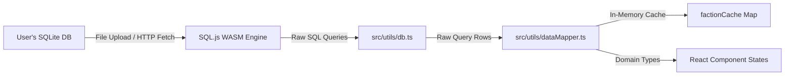

# Data & Mapping Architecture

The **Data & Mapping Architecture** defines how Tactical Cognis loads, queries, and maps Warhammer 40k companion app databases entirely in-client. 

Because the application is designed to be **IP-free**, it hosts no pre-packaged game data. Instead, it mounts a raw SQLite file at runtime, queries relational tables using a WebAssembly runtime, maps rows into unified TypeScript entities, and caches outputs in memory.

---

## 🏗️ Architectural Flow

The flow of data from raw SQLite schemas to UI component states is organized as follows:



---

## 🔌 Database Layer (`db.ts`)

Located in [src/utils/db.ts](https://github.com/georgestephanis/tactical-cognis/blob/trunk/src/utils/db.ts), this file is the sole interface that interacts directly with the `sql.js` WASM engine.

### 1. Initialization Logic (`initDatabase`)
- Checks if the library is already active.
- Fetches `/sql-wasm.wasm` as a binary `ArrayBuffer` and passes it to the `initSqlJs` constructor.
- Attempts to fetch `/40k.sqlite` from the HTTP server. If not found, or if the server redirects to a default HTML fallback (e.g. `index.html`), it skips auto-initialization and permits the UI to fall back to the Upload screen.

### 2. Relational Queries
- **`getUnitsByFaction(factionSlug)`:** The primary datasheet query. Resolves meta-faction mappings (e.g., expanding `aeldari` to child keywords `asuryani`, `harlequins`, and `ynnari`), queries the `datasheet` table, and joins:
  - `miniature`: Resolves individual miniature statlines.
  - `invulnerable_save`: Combines ranged and melee saves, prioritizing miniature-specific overrides.
  - `datasheet_damage`: Loads damaged stat bracket rules.
  - `unit_composition` & `unit_composition_miniature`: Extracts sizing counts and points cost levels.
  - `datasheet_points_step`: Loads stepped points pricing rules for duplicate units.
  - `datasheet_datasheet_ability` & `datasheet_ability`: Resolves core, faction, and datasheet rules.
  - `datasheet_bodyguard_group`: Resolves character lead and bodyguard capabilities (`Datasheet.leads`) — a unit's *intrinsic* ability to lead/support a squad.
  - `datasheet_sub_ability`: Nests named sub-effects under a parent ability (`Ability.subAbilities`) — e.g. the individually-named relics under a "choose one relic" ability.
  - `wargear_item_profile` & `base_miniature_loadout`: Maps baseline weapons configurations, including each profile's `hunterProfileKeyword` (parsed onto `WeaponProfile.hunterKeywords` — see *Conditional weapon profiles* below).
  - `all_model_wargear_choice(_set/_wargear_item)` and `wargear_option_group.instructionText`: Synthesized/surfaced as descriptive prose (`Datasheet.allModelWargearOptions`, `Datasheet.wargearInstructions`) alongside the structured `loadout_choice*` picker — display-only, not a separate legality mechanism.
- **`getDetachmentsByFaction(factionSlug)`:** Resolves detachment rules, stratagems, enhancements, unique keyword restrictions, and **force dispositions** (`detachment_force_disposition` → `MergedDetachment.forceDispositions`). A detachment normally maps to exactly one disposition, but may offer several to choose between — the Army Builder renders a selector in that case and validates that a pick has been made. The disposition query is `try/catch`-guarded and degrades to `[]`. Also resolves **enhancement-granted leadership** (`enhancement_bodyguard_group` + `_datasheet`/`_keyword` → `AppEnhancement.grantsLeadership`) — the same "leader may lead this squad" relationship as `datasheet_bodyguard_group`, but scoped to an equipped enhancement rather than intrinsic to the datasheet (e.g. the Orks' *Kaptin's Hat* letting its wearer additionally lead Flash Gitz). `grantsLeadership` entries carry a `bodyguardType` of `leader` or `support`; the Army Builder's attachment logic (`checkCompatibility`/`canAttachCharacterToSquad`) reads both this and the intrinsic `leads` list. An enhancement's `requiredKeywordGroups` (eligibility) now also folds in declared faction sub-keyword gates (`enhancement_required_keyword_group_faction_keyword`) alongside ordinary unit-keyword requirements — same AND-within/OR-across-group semantics, so `isUnitEligibleForEnhancement`'s callers feed `Datasheet.factionKeywords` into the keyword pool, not just model keywords. Stratagems carry `phases` (`stratagem_phase`, humanized) and detachments carry `details` (`detachment_detail*` — "why take this" flavor bullets) and `linkedDatasheets` (`detachment_linked_datasheet` — bundled units, e.g. a Combat-Patrol-style box set). All guarded queries, degrade to `[]`.
- **`getFactionList()`:** Computes top-level statistics (counts of units and detachments per faction) directly from the database to populate the Home dashboard.
- **`getAlliedUnitsForFaction(factionSlug)` / `getAlliedLimitsForFaction(factionSlug)`:** Resolve the `allied_faction*` tables into allied datasheets (surfaced as `MergedFaction.alliedUnits`) and per-ally points caps (`MergedFaction.alliedLimits`) used by the Army Builder's Allies category and validation. Each allied unit is labeled with its source faction (`allied_faction_parent_faction_keyword` → `MergedUnit.alliedSourceFactionName`, display-only). Each keyword-based cap can carry `donorKeywords` (`allied_faction_keyword_slotless_keyword_group(_donor_keyword)`) — a unit carrying a donor keyword (e.g. "Inquisitor") counts toward a cap even though it doesn't natively carry the cap's own keyword (e.g. "Retinue", which no datasheet carries literally); without this, such caps silently matched nothing.
- **`getSavedDbRosters()` / `getDbRosterDetail(rosterId)`:** Read the user's own saved army lists out of the companion app's `roster*` tables — units, per-model counts, wargear selections, enhancements, warlord flags, leader→bodyguard attachment groups, and any declared allegiance abilities (`roster_unit_allegiance_ability`) — so the Army Builder can import them directly. Both tolerate databases without roster tables (`getSavedDbRosters()` returns `[]` rather than throwing), and faction keywords that the app folds into meta-factions (e.g. Heretic Astartes) are remapped to their importable slug.

#### List-legality & allegiance helpers

These resolve machine-readable roster rules into name-keyed shapes the Army Builder matches against the current roster. All are `try/catch`-guarded and degrade to `[]` on databases missing the table.

- **`getConditionalKeywordGrants(factionSlug)`:** Rules that grant a keyword to a unit conditionally (detachment, declared allegiance ability, declared sub-faction keyword, or a single-model Warlord). Every gate is returned as a human-readable name; `applyKeywordGrants` in the Army Builder unions the granted keyword onto a unit only when the gate is satisfied.
- **`getExcludedDatasheets(factionSlug)`:** Units barred from a detachment (`detachment_excluded_datasheet`) or the whole faction (`faction_keyword_excluded_datasheet`).
- **`getKeywordRestrictionGroups(factionSlug)`:** Per-roster "0-1 X" caps (`keyword_restriction_group*`), with per-detachment min/max overrides, an optional Warlord gate, and an excluded-sub-faction-keyword that lifts the cap.
- **`getDetachmentWarlordRules(factionSlug)`:** Detachment-scoped mandatory/granted Warlord units — the DB-driven, authoritative version of intrinsic "Supreme Commander" auto-designation.
- **`getAllegianceGroups(factionSlug)`:** Allegiance / sub-faction choice-sets — structured `allegiance_ability_group` choices (Marks of Chaos, Daemonic Allegiance, …) plus a synthetic group of declarable sub-faction keywords (e.g. Space Marine Chapters). Drives the Army Builder's allegiance selector; selections unlock the gated conditional-keyword grants.
- **`getArmyRules(factionSlug)`:** Army-wide special rules (Oath of Moment, Acts of Faith) with prose from `rule_container_component`. Display-only.

### 3. Schema-Version Tolerance
Uploaded databases come from different companion-app versions, so queries against tables whose shape changed between versions are guarded. Example: per-datasheet wargear limits are only queried after a `PRAGMA table_info(wargear_limit)` check confirms the `datasheetId` column exists; older DBs (where `wargear_limit` is keyed by `limitedWargearChoiceSetId`) skip wargear limits instead of failing the entire faction load.

For **columns** added by a newer release, `db.ts` exports a cached probe rather than repeating ad-hoc `PRAGMA` calls:

```typescript
export async function hasColumn(table: string, column: string): Promise<boolean>
```

Results are memoised per table and the cache is cleared whenever a database is opened. Callers build the column into the projection conditionally, so an older DB degrades to a default instead of failing the load:

```typescript
const legendsCol = (await hasColumn('datasheet', 'isLegends')) ? 'd.isLegends' : '0 AS isLegends';
```

The three columns currently probed all arrived with the 11th-edition data (data version 946): `datasheet.isLegends`, `publication.isCombatPatrol`, and `wargear_item_profile.hunterProfileKeyword`.

### 4. Conditional weapon profiles (`hunterProfileKeyword`)

Most multi-profile weapons offer every profile simultaneously. A **Hunter** profile does not: it is a statline usable *only* against targets carrying specific keywords, paired with a `Standard` profile used against everything else.

`db.ts` exports `parseHunterKeywords()`, which normalises the database's emphasised, slash-separated prose (`**MONSTER/VEHICLE**`) into `['MONSTER', 'VEHICLE']` on `WeaponProfile.hunterKeywords`. Ordinary profiles get `[]`.

The **decision** logic deliberately lives in the dependency-free engine (`mathhammer.ts`) so it is unit-testable — see [mathhammer_engine.md](./mathhammer_engine.md). Any consumer that aggregates a weapon's output must route through `selectProfilesForTarget()`; summing all profiles of a Hunter weapon roughly doubles its damage.

---

## 🗺️ Mapping Layer (`dataMapper.ts`)

Located in [src/utils/dataMapper.ts](https://github.com/georgestephanis/tactical-cognis/blob/trunk/src/utils/dataMapper.ts), this file bridges database row states with React domain interfaces.

### 1. Cache Control
Because complex SQL joins are computationally expensive on the single-threaded WASM thread, `loadAndMergeFaction(factionSlug)` utilizes an in-memory cache:
```typescript
const factionCache = new Map<string, MergedFaction>();
```
If a faction is queried once, subsequent page-state transitions retrieve it instantly.

### 2. Sizing & Point Resolution
SQLite stores points cost tiers in `unit_composition` (a text column of points and a display order). The mapper:
- Isolates valid points tiers.
- Sums the maximum limits of miniatures in `unit_composition_miniature` to calculate the exact squad sizes purchaseable by those points.
- Computes `pointsRange` (`min` and `max` values) to populate UI labels on Faction grids.
- Identifies **Combat Patrols** from `publication.isCombatPatrol`, falling back to a `"combat patrol"` publication-name check and then a zero-points check for older databases.
- Propagates `isLegends` onto `MergedUnit` so Warhammer Legends datasheets can be filtered and flagged (they are hidden by default and are not legal in matched play).

---

## 🏷️ TypeScript Entity Specifications

The core types are defined in [src/types/data.ts](https://github.com/georgestephanis/tactical-cognis/blob/trunk/src/types/data.ts) and govern the states:

### 1. `MergedUnit`
Unifies the metadata used by Faction cards, detail overlays, and the Army Builder catalog:
```typescript
export interface MergedUnit {
  name: string;
  slug: string;
  appDatasheet: Datasheet | null;
  pointsRange: { min: number; max: number };
  isCombatPatrol: boolean;
  isLegends: boolean; // Warhammer Legends datasheet — not legal in matched play
  isFactionPack?: boolean;
  isAllied?: boolean; // Unit comes from an allied faction (Army Builder "Allies" category)
  requiredDetachmentIds?: string[]; // Allied unit only selectable in these detachments
}
```

The merged blob the Army Builder consumes, `MergedFaction` (in [dataMapper.ts](https://github.com/georgestephanis/tactical-cognis/blob/trunk/src/utils/dataMapper.ts)), carries the faction's `units`/`alliedUnits`/`detachments` plus the list-legality and allegiance data assembled by the helpers above: `conditionalKeywordGrants`, `excludedDatasheets`, `keywordRestrictionGroups`, `detachmentWarlordRules`, `allegianceGroups`, and `armyRules`. The declared allegiance itself (`selectedAllegianceAbilityIds`, `selectedSubfactionKeywords`) lives on the `ArmyList` roster state and is persisted to `localStorage`.

### 2. `RosterUnit`
Represents a configured unit added to a force roster inside the Army Builder:
```typescript
export interface RosterUnit {
  id: string; // Unique instance ID
  unitSlug: string;
  name: string;
  points: number;
  modelsCount: number;
  isCharacter: boolean;
  isBattleline: boolean;
  isFactionPack: boolean;
  selectedCostIndex: number;
  attachedToId?: string; // ID of target bodyguard squad
  enhancementName?: string;
  enhancementPoints?: number;
  isWarlord?: boolean;
  selectedWargearChoices?: Record<string, string[]>; // choiceSetId -> choiceId[]
  wargearCounts?: Record<string, number>; // choiceId -> count selected
  splitSquad?: boolean; // Squad is split into two halves pre-game (Combat Squads)
}
```
