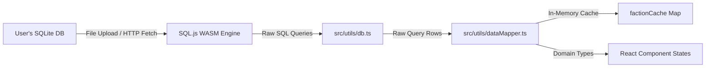

# Data & Mapping Architecture

The **Data & Mapping Architecture** defines how Tactical Cognis loads, queries, and maps Warhammer 40k companion app databases entirely in-client. 

Because the application is designed to be **IP-free**, it hosts no pre-packaged game data. Instead, it mounts a raw SQLite file at runtime, queries relational tables using a WebAssembly runtime, maps rows into unified TypeScript entities, and caches outputs in memory.

---

## 🏗️ Architectural Flow

The flow of data from raw SQLite schemas to UI component states is organized as follows:



---

## 🔌 Database Layer (`db.ts`)

Located in [src/utils/db.ts](https://github.com/georgestephanis/tactical-cognis/blob/trunk/src/utils/db.ts), this file is the sole interface that interacts directly with the `sql.js` WASM engine.

### 1. Initialization Logic (`initDatabase`)
- Checks if the library is already active.
- Fetches `/sql-wasm.wasm` as a binary `ArrayBuffer` and passes it to the `initSqlJs` constructor.
- Attempts to fetch `/40k.sqlite` from the HTTP server. If not found, or if the server redirects to a default HTML fallback (e.g. `index.html`), it skips auto-initialization and permits the UI to fall back to the Upload screen.

### 2. Relational Queries
- **`getUnitsByFaction(factionSlug)`:** The primary datasheet query. Resolves meta-faction mappings (e.g., expanding `aeldari` to child keywords `asuryani`, `harlequins`, and `ynnari`), queries the `datasheet` table, and joins:
  - `miniature`: Resolves individual miniature statlines.
  - `invulnerable_save`: Combines ranged and melee saves, prioritizing miniature-specific overrides.
  - `datasheet_damage`: Loads damaged stat bracket rules.
  - `unit_composition` & `unit_composition_miniature`: Extracts sizing counts and points cost levels.
  - `datasheet_points_step`: Loads stepped points pricing rules for duplicate units.
  - `datasheet_datasheet_ability` & `datasheet_ability`: Resolves core, faction, and datasheet rules.
  - `datasheet_bodyguard_group`: Resolves character lead and bodyguard capabilities.
  - `wargear_item_profile` & `base_miniature_loadout`: Maps baseline weapons configurations.
- **`getDetachmentsByFaction(factionSlug)`:** Resolves detachment rules, stratagems, enhancements, and unique keyword restrictions.
- **`getFactionList()`:** Computes top-level statistics (counts of units and detachments per faction) directly from the database to populate the Home dashboard.
- **`getAlliedUnitsForFaction(factionSlug)` / `getAlliedLimitsForFaction(factionSlug)`:** Resolve the `allied_faction*` tables into allied datasheets (surfaced as `MergedFaction.alliedUnits`) and per-ally points caps (`MergedFaction.alliedLimits`) used by the Army Builder's Allies category and validation.
- **`getSavedDbRosters()` / `getDbRosterDetail(rosterId)`:** Read the user's own saved army lists out of the companion app's `roster*` tables — units, per-model counts, wargear selections, enhancements, warlord flags, leader→bodyguard attachment groups, and any declared allegiance abilities (`roster_unit_allegiance_ability`) — so the Army Builder can import them directly. Both tolerate databases without roster tables (`getSavedDbRosters()` returns `[]` rather than throwing), and faction keywords that the app folds into meta-factions (e.g. Heretic Astartes) are remapped to their importable slug.

#### List-legality & allegiance helpers

These resolve machine-readable roster rules into name-keyed shapes the Army Builder matches against the current roster. All are `try/catch`-guarded and degrade to `[]` on databases missing the table.

- **`getConditionalKeywordGrants(factionSlug)`:** Rules that grant a keyword to a unit conditionally (detachment, declared allegiance ability, declared sub-faction keyword, or a single-model Warlord). Every gate is returned as a human-readable name; `applyKeywordGrants` in the Army Builder unions the granted keyword onto a unit only when the gate is satisfied.
- **`getExcludedDatasheets(factionSlug)`:** Units barred from a detachment (`detachment_excluded_datasheet`) or the whole faction (`faction_keyword_excluded_datasheet`).
- **`getKeywordRestrictionGroups(factionSlug)`:** Per-roster "0-1 X" caps (`keyword_restriction_group*`), with per-detachment min/max overrides, an optional Warlord gate, and an excluded-sub-faction-keyword that lifts the cap.
- **`getDetachmentWarlordRules(factionSlug)`:** Detachment-scoped mandatory/granted Warlord units — the DB-driven, authoritative version of intrinsic "Supreme Commander" auto-designation.
- **`getAllegianceGroups(factionSlug)`:** Allegiance / sub-faction choice-sets — structured `allegiance_ability_group` choices (Marks of Chaos, Daemonic Allegiance, …) plus a synthetic group of declarable sub-faction keywords (e.g. Space Marine Chapters). Drives the Army Builder's allegiance selector; selections unlock the gated conditional-keyword grants.
- **`getArmyRules(factionSlug)`:** Army-wide special rules (Oath of Moment, Acts of Faith) with prose from `rule_container_component`. Display-only.

### 3. Schema-Version Tolerance
Uploaded databases come from different companion-app versions, so queries against tables whose shape changed between versions are guarded. Example: per-datasheet wargear limits are only queried after a `PRAGMA table_info(wargear_limit)` check confirms the `datasheetId` column exists; older DBs (where `wargear_limit` is keyed by `limitedWargearChoiceSetId`) skip wargear limits instead of failing the entire faction load.

---

## 🗺️ Mapping Layer (`dataMapper.ts`)

Located in [src/utils/dataMapper.ts](https://github.com/georgestephanis/tactical-cognis/blob/trunk/src/utils/dataMapper.ts), this file bridges database row states with React domain interfaces.

### 1. Cache Control
Because complex SQL joins are computationally expensive on the single-threaded WASM thread, `loadAndMergeFaction(factionSlug)` utilizes an in-memory cache:
```typescript
const factionCache = new Map<string, MergedFaction>();
```
If a faction is queried once, subsequent page-state transitions retrieve it instantly.

### 2. Sizing & Point Resolution
SQLite stores points cost tiers in `unit_composition` (a text column of points and a display order). The mapper:
- Isolates valid points tiers.
- Sums the maximum limits of miniatures in `unit_composition_miniature` to calculate the exact squad sizes purchaseable by those points.
- Computes `pointsRange` (`min` and `max` values) to populate UI labels on Faction grids.
- Identifies **Combat Patrols** automatically by checking if publication headers include `"combat patrol"` or if points are set to 0.

---

## 🏷️ TypeScript Entity Specifications

The core types are defined in [src/types/data.ts](https://github.com/georgestephanis/tactical-cognis/blob/trunk/src/types/data.ts) and govern the states:

### 1. `MergedUnit`
Unifies the metadata used by Faction cards, detail overlays, and the Army Builder catalog:
```typescript
export interface MergedUnit {
  name: string;
  slug: string;
  appDatasheet: Datasheet | null;
  pointsRange: { min: number; max: number };
  isCombatPatrol: boolean;
  isFactionPack?: boolean;
  isAllied?: boolean; // Unit comes from an allied faction (Army Builder "Allies" category)
  requiredDetachmentIds?: string[]; // Allied unit only selectable in these detachments
}
```

The merged blob the Army Builder consumes, `MergedFaction` (in [dataMapper.ts](https://github.com/georgestephanis/tactical-cognis/blob/trunk/src/utils/dataMapper.ts)), carries the faction's `units`/`alliedUnits`/`detachments` plus the list-legality and allegiance data assembled by the helpers above: `conditionalKeywordGrants`, `excludedDatasheets`, `keywordRestrictionGroups`, `detachmentWarlordRules`, `allegianceGroups`, and `armyRules`. The declared allegiance itself (`selectedAllegianceAbilityIds`, `selectedSubfactionKeywords`) lives on the `ArmyList` roster state and is persisted to `localStorage`.

### 2. `RosterUnit`
Represents a configured unit added to a force roster inside the Army Builder:
```typescript
export interface RosterUnit {
  id: string; // Unique instance ID
  unitSlug: string;
  name: string;
  points: number;
  modelsCount: number;
  isCharacter: boolean;
  isBattleline: boolean;
  isFactionPack: boolean;
  selectedCostIndex: number;
  attachedToId?: string; // ID of target bodyguard squad
  enhancementName?: string;
  enhancementPoints?: number;
  isWarlord?: boolean;
  selectedWargearChoices?: Record<string, string[]>; // choiceSetId -> choiceId[]
  wargearCounts?: Record<string, number>; // choiceId -> count selected
  splitSquad?: boolean; // Squad is split into two halves pre-game (Combat Squads)
}
```
