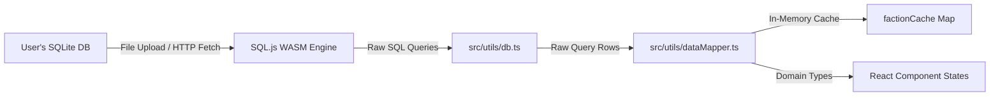

# Data & Mapping Architecture

The **Data & Mapping Architecture** defines how Tactical Cognis loads, queries, and maps Warhammer 40k companion app databases entirely in-client. 

Because the application is designed to be **IP-free**, it hosts no pre-packaged game data. Instead, it mounts a raw SQLite file at runtime, queries relational tables using a WebAssembly runtime, maps rows into unified TypeScript entities, and caches outputs in memory.

---

## 🏗️ Architectural Flow

The flow of data from raw SQLite schemas to UI component states is organized as follows:



---

## 🔌 Database Layer (`db.ts`)

Located in [src/utils/db.ts](file:///Users/georgestephanis/code/tactical-cognis/src/utils/db.ts), this file is the sole interface that interacts directly with the `sql.js` WASM engine.

### 1. Initialization Logic (`initDatabase`)
- Checks if the library is already active.
- Fetches `/sql-wasm.wasm` as a binary `ArrayBuffer` and passes it to the `initSqlJs` constructor.
- Attempts to fetch `/40k.sqlite` from the HTTP server. If not found, or if the server redirects to a default HTML fallback (e.g. `index.html`), it skips auto-initialization and permits the UI to fall back to the Upload screen.

### 2. Relational Queries
- **`getUnitsByFaction(factionSlug)`:** The primary datasheet query. Resolves meta-faction mappings (e.g., expanding `aeldari` to child keywords `asuryani`, `harlequins`, and `ynnari`), queries the `datasheet` table, and joins:
  - `miniature`: Resolves individual miniature statlines.
  - `invulnerable_save`: Combines ranged and melee saves, prioritizing miniature-specific overrides.
  - `datasheet_damage`: Loads damaged stat bracket rules.
  - `unit_composition` & `unit_composition_miniature`: Extracts sizing counts and points cost levels.
  - `datasheet_datasheet_ability` & `datasheet_ability`: Resolves core, faction, and datasheet rules.
  - `datasheet_bodyguard_group`: Resolves character lead and bodyguard capabilities.
  - `wargear_item_profile` & `base_miniature_loadout`: Maps baseline weapons configurations.
- **`getDetachmentsByFaction(factionSlug)`:** Resolves detachment rules, stratagems, enhancements, and unique keyword restrictions.
- **`getFactionList()`:** Computes top-level statistics (counts of units and detachments per faction) directly from the database to populate the Home dashboard.

---

## 🗺️ Mapping Layer (`dataMapper.ts`)

Located in [src/utils/dataMapper.ts](file:///Users/georgestephanis/code/tactical-cognis/src/utils/dataMapper.ts), this file bridges database row states with React domain interfaces.

### 1. Cache Control
Because complex SQL joins are computationally expensive on the single-threaded WASM thread, `loadAndMergeFaction(factionSlug)` utilizes an in-memory cache:
```typescript
const factionCache = new Map<string, MergedFaction>();
```
If a faction is queried once, subsequent page-state transitions retrieve it instantly.

### 2. Sizing & Point Resolution
SQLite stores points cost tiers in `unit_composition` (a text column of points and a display order). The mapper:
- Isolates valid points tiers.
- Sums the maximum limits of miniatures in `unit_composition_miniature` to calculate the exact squad sizes purchaseable by those points.
- Computes `pointsRange` (`min` and `max` values) to populate UI labels on Faction grids.
- Identifies **Combat Patrols** automatically by checking if publication headers include `"combat patrol"` or if points are set to 0.

---

## 🏷️ TypeScript Entity Specifications

The core types are defined in [src/types/data.ts](file:///Users/georgestephanis/code/tactical-cognis/src/types/data.ts) and govern the states:

### 1. `MergedUnit`
Unifies the metadata used by Faction cards, detail overlays, and the Army Builder catalog:
```typescript
export interface MergedUnit {
  name: string;
  slug: string;
  appDatasheet: Datasheet;
  pointsRange: { min: number; max: number };
  isCombatPatrol: boolean;
  isFactionPack: boolean;
}
```

### 2. `RosterUnit`
Represents a configured unit added to a force roster inside the Army Builder:
```typescript
export interface RosterUnit {
  id: string; // Unique instance ID generated at runtime
  unit: MergedUnit; // Source unit metadata
  selectedCostIndex: number; // Selected points sizing tier
  selectedModels: number; // Configured model count
  selectedPoints: number; // Configured points cost
  isWarlord: boolean; // Flagged warlord
  attachedEnhancement: AppEnhancement | null; // Attached enhancement card
  attachedBodyguardId?: string; // Target bodyguard unit instance ID
  attachedLeaderIds?: string[]; // Indented character instance IDs
}
```
