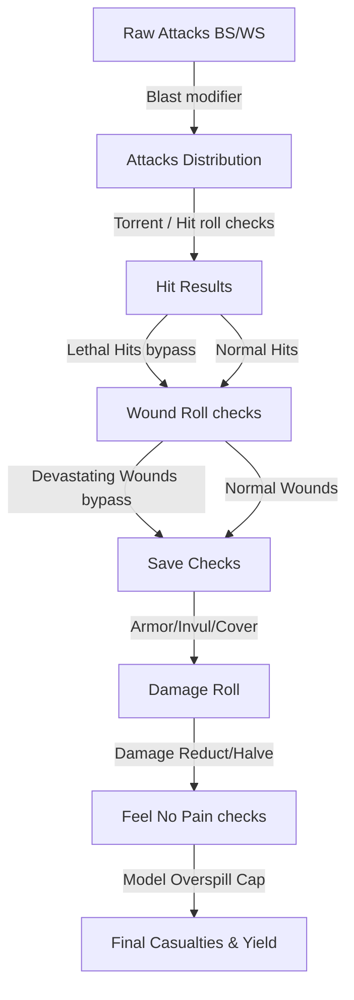

# Mathhammer Combat Simulation Engine

The **Mathhammer Combat Simulation Engine** is the analytical core of the Tactical Cognis application. It provides pure mathematical probability models for simulating combat sequences in Warhammer 40k. It operates independently of the database schema and React rendering cycles, located in [src/utils/mathhammer.ts](https://github.com/georgestephanis/tactical-cognis/blob/trunk/src/utils/mathhammer.ts).

---

## 📐 Data Schemas & Types

### 1. Attacker Input (`MathhammerInput`)
Represents the statistics and special rules of the weapon profile, plus active buffs:
- `attacks` (string): Text formula for attacks count (e.g., `'4'`, `'D6'`, `'2D6+3'`).
- `bsWs` (number): Target roll on D6 (e.g., `3` for a `3+` skill).
- `strength` (number), `ap` (number), `damage` (string)
- **Special Weapon Rules:** `torrent`, `twinLinked`, `lethalHits`, `sustainedHits` (integer value), `devastatingWounds`, `blast`.
- **Active Buffs:** `hitReRoll` and `woundReRoll` (`'none' | 'ones' | 'all'`), `plusToHit` and `plusToWound` modifier values, `antiKeyword` and `antiValue` (critical triggers, e.g. `'INFANTRY'` on `4+`).
- **Advanced 11th Edition Attacker Settings (Optional):**
  - `isMelee` (boolean): Flag indicating a melee weapon (influences melee invulnerable save checks).
  - `ignoresCover` (boolean): Bypasses cover-based ballistic skill penalties.
  - `ignoresHitPenalties` / `ignoresWoundPenalties` (boolean): Ignores negative roll modifiers.
  - `critHitThreshold` / `critWoundThreshold` (number): Unmodified D6 threshold to trigger critical results (defaults to `6`).
  - `indirectFire` (boolean): Shoots indirectly; caps hit roll to a maximum of 4+ (3/6 chance).
  - `snapShots` (boolean): Hard caps hit roll to a flat 6+ (1/6 chance).
  - `melta` (number): Flat bonus damage added to weapon damage profiles at close range.
  - `flatMortals` (number): Flat mortal wounds generated per attack.

### 2. Defender Profile (`TargetProfile`)
Represents the baseline and advanced defense profile of the target squad:
- `t` (Toughness), `sv` (Armor Save, e.g., `3` for `3+`), `inv` (Invulnerable Save, e.g., `4++`), `w` (Wounds per model), `fnp` (Feel No Pain save), `keywords` (uppercase strings list), `unitSize` (total models).
- **Advanced 11th Edition Defender Modifiers (Optional):**
  - `cover` (boolean): Active cover modifier (worsens shooter's BS by 1).
  - `invMelee` / `invRanged` (number | null): Melee/ranged-specific invulnerable save overrides.
  - `apReduction` (number): Reduces weapon AP penalty by this amount (e.g., Armor of Contempt).
  - `hitPenalty` / `woundPenalty` (number): Applies a penalty to hit/wound rolls (max capped at -1).
  - `noHitReRolls` / `noWoundReRolls` (boolean): Gating options to deny attacker re-rolls.
  - `transhuman` (boolean): Constraint forcing unmodified wound rolls of 1-3 to fail automatically.
  - `damageReduction` (number): Subtracted from incoming weapon damage (to a minimum of 1).
  - `halveDamage` (boolean): Halves incoming weapon damage (rounded up).
  - `mwFnp` (number | null): Feel No Pain save against mortal wounds/devastating wounds.

---

## 🧮 Core Simulation Formulas

The engine evaluates outcomes sequentially, simulating the Warhammer 40k attack sequence using expected value equations.



### 1. Attack Calculation
The attacks expression is parsed using `parseDiceAverage(expr)`. If the weapon has the **Blast** rule, the expected attack value is adjusted:
$$\text{Expected Attacks} = \text{Parsed Base Attacks} + \left( \lfloor \frac{\text{Target Unit Size}}{5} \rfloor \times 1 \right)$$

### 2. Hit Roll Sequence
Calculates expected hits (`expectedHits`) and critical hits (`critHits`):
- **Torrent:** Auto-hits, bypassing the hit roll. $\text{Expected Hits} = \text{Expected Attacks}$.
- **Benefit of Cover (11th Edition):** If the target is in cover (and `ignoresCover` is false, and weapon is not melee), the shooter's Ballistic Skill (`bsWs`) is worsened by 1:
  $$\text{Modified BS} = \text{bsWs} + 1$$
- **Hit Roll Modifiers:** Standard roll succeeds if $\text{Roll} \ge \text{Modified BS} - \text{cappedHitMod}$.
  - The net modifier (`plusToHit` - `hitPenalty`) is capped between $[-1, 1]$.
  - The final required roll is constrained between $[2, 6]$ (unmodified 1 always fails).
- **Snap Shots & Indirect Fire Caps:**
  - *Snap Shots:* Hard caps hit chance to $1/6$.
  - *Indirect Fire:* Caps hit chance to a maximum of $3/6$ (4+ target).
- **Re-rolls:**
  - *Ones:* adds $P/6$ to the success chance $P$ (hit or wound).
  - *All:* adds $(1-P)\cdot P$.
  - Hit re-rolls are denied by `noHitReRolls`, wound re-rolls by `noWoundReRolls`.
- **Sustained Hits:** Each critical hit (unmodified roll of `critHitThreshold`, or `6` by default) generates $X$ extra hits.
- **Lethal Hits:** Critical hits skip the wound roll and generate automatic wounds directly.

### 3. Wound Roll Sequence
Compares weapon Strength ($S$) vs target Toughness ($T$):
- **Base Wound Target:**
  - $S \ge 2T \implies 2+$
  - $S > T \implies 3+$
  - $S = T \implies 4+$
  - $S < T \implies 5+$
  - $S \le T/2 \implies 6+$
- **Critical Wounds / Anti-Keywords:** If the target matches `antiKeyword`, unmodified wound rolls of `antiValue` or higher trigger critical wounds.
- **Twin-Linked** (or `woundReRoll: 'all'`) re-rolls all failed wound rolls; `woundReRoll: 'ones'` re-rolls 1s.
- **Wound modifiers:** net `plusToWound − woundPenalty` (the penalty is ignored with `ignoresWoundPenalties`) is capped to $[-1,+1]$, the final target is clamped to $[2,6]$, and `transhuman` raises the target to at least 4+ after modifiers. `critWoundThreshold` (default 6) sets the critical-wound roll when no anti-keyword applies.

### 4. Saving Throws
Calculates how many wounds pass through target armor and invulnerable saves:
- **Modified AP:** Calculated by subtracting `apReduction` from the weapon's `ap` value (AP is treated as a negative number, with a maximum penalty of 0):
  $$\text{Modified AP} = \min(0, \text{ap} + \text{apReduction})$$
- **Modified Save Target:** The defender's armor save modified by the AP:
  $$\text{Modified Save Target} = \text{Target Save} - \text{Modified AP}$$
- **Active Save:** The engine selects the best save value between the modified armor save and the target's invulnerable save. If `isMelee` is true, the `invMelee` override is preferred; if false, `invRanged` is preferred, falling back to `inv` in both cases if no override is set:
  $$\text{Active Save} = \min(\text{Modified Save Target}, \text{Invulnerable Save})$$
  *(The save roll chance is capped at a maximum success of 5/6, as unmodified 1s always fail).*
- **Devastating Wounds:** Critical wounds skip this step entirely and proceed directly to damage calculations as unsaved wounds.

### 5. Damage Allocation & Feel No Pain (FNP)
Expected damage is allocated to models. Unused damage on a model does not carry over to the next model (overkill damage is lost):
- **Damage Modification:** Applied to the damage expression output (Melta is added first, then the damage is optionally halved and rounded up, then `damageReduction` is subtracted to a minimum of 1).
- **Feel No Pain:** The defender rolls a D6 for each wound allocated. The failure probability is:
  $$P(\text{Fail}) = \frac{\text{fnp} - 1}{6}$$
- **Casualties Expectation:**
  With no FNP, the expected damage landing per wound is $W / \lceil W/\text{dmg}\rceil$ (overkill is wasted). With FNP, `expectedFlatDamageAfterFnp(damage, modelWounds, fnpFailChance)` applies the reference spreadsheet's cap-and-heuristic logic, and Devastating Wounds and flat mortal wounds use the mortal-wound FNP. Casualties are the effective damage divided by the target's wounds $W$.

---

## 🎲 Dice Parser & Probability Distribution

Located in `parseDiceAverage` and `getDiceDistribution`:
- **Averages:** The expected value of a variable $D_n$ die is:
  $$E[D_n] = \frac{n + 1}{2}$$
- **Distribution Mapping:** For complex expressions like `2D6+3`, the engine uses standard convolution mappings (generating combinations via mapping arrays) to return the exact probability density function for every sum outcome value, which is then used to compute non-linear damage reduction caps accurately.

---

## 🎯 Profile Selection (Conditional "Hunter" Profiles)

Before any of the math above runs, a caller has to decide **which** of a weapon's profiles is actually being fired. For most weapons the answer is "all of them" — a combi-weapon's profiles are simultaneously available, so their damage sums.

A **Hunter** profile breaks that assumption. It is a statline usable *only* against targets carrying particular keywords, paired with a `Standard` profile used against everything else — the two are mutually exclusive. Summing both roughly **doubles** the weapon's output.

The engine therefore exposes two pure helpers (no DB or React dependency, consistent with the rest of this module):

```typescript
export interface ConditionalProfile {
  name?: string;
  hunterKeywords?: string[];  // empty/absent for ordinary profiles
}

profileAppliesToTarget(profile: ConditionalProfile, targetKeywords: string[]): boolean
selectProfilesForTarget<T extends ConditionalProfile>(profiles: T[], targetKeywords: string[]): T[]
```

**Matching rules.** Keywords are OR'd and compared case-insensitively, mirroring the `MONSTER/VEHICLE` form the database stores. A profile with no `hunterKeywords` always applies.

**Selection rules** for `selectProfilesForTarget`:

| Weapon shape | Target matches? | Returned |
| --- | --- | --- |
| No Hunter profile | — | every profile (unchanged) |
| Hunter + Standard | yes | the Hunter profile only |
| Hunter + Standard | no | the unconditional profile(s) |
| Hunter only | no | `[]` — nothing, rather than an illegal statline |

`ConditionalProfile` is structural, so a full `WeaponProfile` satisfies it without this module importing the data-layer types. The keyword list itself is parsed upstream by `parseHunterKeywords()` in `db.ts`.

**Consumers.** `DeepAnalysis` routes its per-weapon damage aggregation through `selectProfilesForTarget()` against the active target preset. `UnitDetails` uses `profileAppliesToTarget()` to grey out preset rows a manually-selected Hunter profile could not legally be used against, instead of reporting damage figures for an illegal attack.

---

## ✅ Unit Test Coverage

The engine has a zero-dependency test suite at [tests/mathhammer.test.ts](../tests/mathhammer.test.ts) (plain `assert` calls, run via `tsx`):

```bash
npm test
```

`npm test` also runs the `rosterPrint`, `loadout` and `missionIntel` suites. The mathhammer suite covers dice-expression parsing and probability distributions, Feel No Pain (binomial), hit/wound modifiers (including Transhuman-style caps), Benefit of Cover, AP and saving-throw logic, Devastating Wounds, and conditional (Hunter) profile selection. Prefer extending this file (or cloning its pattern) when adding math features.

Note that the Hunter-profile tests use obviously-fake placeholder keywords (`BIGTHING`/`SMALLTHING`) rather than real datasheet values, per the repo's no-GW-IP rule.

---

## Outputs & Presets

`MathhammerResult` carries `expectedAttacks`, `expectedHits` (including lethal-hit auto-wounds), `expectedWounds`, `expectedUnsaved`, `rawDamage`, `effectiveDamage`, `casualties`, `lethalWounds` and `devastatingWoundsCount`. `TARGET_PRESETS` defines the standard defenders (GEQ, MEQ, TEQ, VEQ, HEAVY). `selectProfilesForTarget` returns only the first matching Hunter profile.
