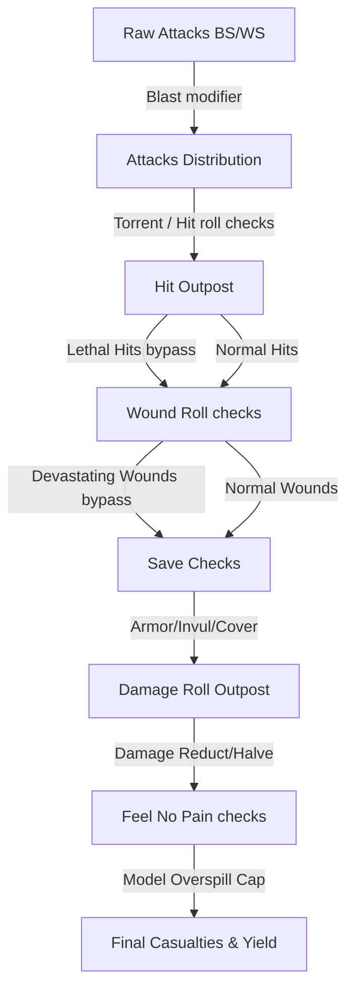

# Mathhammer Combat Simulation Engine

The **Mathhammer Combat Simulation Engine** is the analytical core of the Tactical Cognis application. It provides pure mathematical probability models for simulating combat sequences in Warhammer 40k. It operates independently of the database schema and React rendering cycles, located in [src/utils/mathhammer.ts](file:///Users/georgestephanis/code/tactical-cognis/src/utils/mathhammer.ts).

---

## 📐 Data Schemas & Types

### 1. Attacker Input (`MathhammerInput`)
Represents the statistics and special rules of the weapon profile, plus active buffs:
- `attacks` (string): Text formula for attacks count (e.g., `'4'`, `'D6'`, `'2D6+3'`).
- `bsWs` (number): Target roll on D6 (e.g., `3` for a `3+` skill).
- `strength` (number), `ap` (number), `damage` (string)
- **Special Weapon Rules:** `torrent`, `twinLinked`, `lethalHits`, `sustainedHits` (integer value), `devastatingWounds`, `blast`.
- **Active Buffs:** `hitReRoll` and `woundReRoll` (`'none' | 'ones' | 'all'`), `plusToHit` and `plusToWound` modifier values, `antiKeyword` and `antiValue` (critical triggers, e.g. `'INFANTRY'` on `4+`).

### 2. Defender Profile (`TargetProfile`)
Represents the baseline and advanced defense profile of the target squad:
- `t` (Toughness), `sv` (Armor Save, e.g., `3` for `3+`), `inv` (Invulnerable Save, e.g., `4++`), `w` (Wounds per model), `fnp` (Feel No Pain save), `keywords` (uppercase strings list), `unitSize` (total models).
- **11th Edition Modifiers:** Cover modifiers, AP reduction (e.g. Armor of Contempt), hit/wound penalty caps, transhuman constraints (wound rolls of 1-3 fail), damage reduction/halving, and mortal wound FNP.

---

## 🧮 Core Simulation Formulas

The engine evaluates outcomes sequentially, simulating the Warhammer 40k attack sequence using expected value equations.

### 1. Attack Calculation
The attacks expression is parsed using `parseDiceAverage(expr)`. If the weapon has the **Blast** rule, the expected attack value is adjusted:
$$\text{Expected Attacks} = \text{Parsed Base Attacks} + \left( \lfloor \frac{\text{Target Unit Size}}{5} \rfloor \times 1 \right)$$

### 2. Hit Roll Sequence
Calculates expected hits (`expectedHits`) and critical hits (`critHits`):
- **Torrent:** Auto-hits, bypassing the hit roll. $\text{Expected Hits} = \text{Expected Attacks}$.
- **Hit Roll:** Standard roll succeeds if $\text{Roll} \ge \text{Skill} - \text{plusToHit}$.
- **Re-rolls:**
  - *Ones:* Re-rolls 1s (probability of $+1/6$).
  - *All:* Re-rolls all failed values.
- **Sustained Hits:** Each critical hit (unmodified roll of `6`, or custom threshold) generates $X$ extra hits.
- **Lethal Hits:** Critical hits skip the wound roll and generate automatic wounds directly.

### 3. Wound Roll Sequence
Compares weapon Strength ($S$) vs target Toughness ($T$):
- **Base Wound Target:**
  - $S \ge 2T \implies 2+$
  - $S > T \implies 3+$
  - $S = T \implies 4+$
  - $S < T \implies 5+$
  - $S \le T/2 \implies 6+$
- **Critical Wounds / Anti-Keywords:** If the target matches `antiKeyword`, unmodified wound rolls of `antiValue` or higher trigger critical wounds.
- **Twin-Linked:** Allows re-rolling failed wound rolls (either all failures or ones).

### 4. Saving Throws
Calculates how many wounds pass through target armor and invulnerable saves:
- **Modified Save Target:** $\text{Target Save} + \text{ap} + \text{cover modifier} - \text{apReduction}$.
- **Active Save:** The engine selects the best save value between the modified armor save and the target's invulnerable save.
- **Devastating Wounds:** Critical wounds skip this step entirely and proceed directly to damage calculations as unsaved wounds.

### 5. Damage Allocation & Feel No Pain (FNP)
Expected damage is allocated to models. Unused damage on a model does not carry over to the next model (overkill damage is lost):
- **Damage Modification:** Applied to the damage expression output (first subtracted by `damageReduction` to a minimum of 1, then optionally halved and rounded up).
- **Feel No Pain:** The defender rolls a D6 for each wound allocated. The failure probability is:
  $$P(\text{Fail}) = \frac{\text{fnp} - 1}{6}$$
- **Casualties Expectation:**
  Using binomial distribution functions `expectedFlatDamageAfterFnp(damage, modelWounds, fnpFailChance)`, the engine calculates the expected casualties per attack. Excess damage on a single model is capped at that model's remaining wounds ($W$).

---

## 🎲 Dice Parser & Probability Distribution

Located in `parseDiceAverage` and `getDiceDistribution`:
- **Averages:** The expected value of a variable $D_n$ die is:
  $$E[D_n] = \frac{n + 1}{2}$$
- **Distribution Mapping:** For complex expressions like `2D6+3`, the engine uses standard convolution mappings (generating combinations via mapping arrays) to return the exact probability density function for every sum outcome value, which is then used to compute non-linear damage reduction caps accurately.
