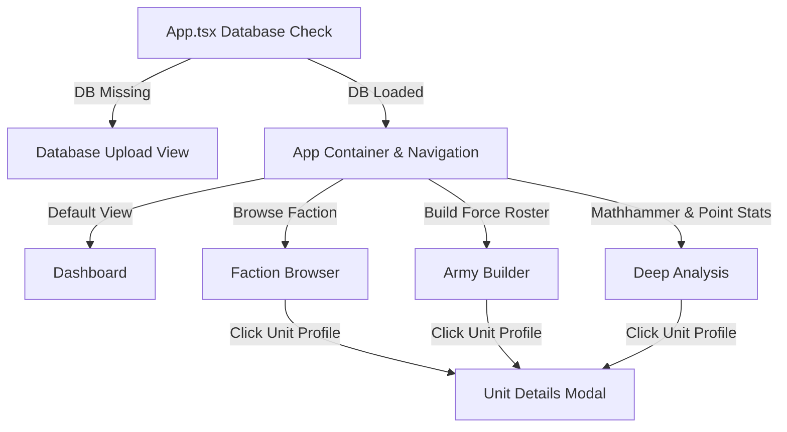

# Tactical Cognis - View Storyboard Index

Welcome to the **Tactical Cognis** UI Storyboard. This folder contains detailed documentation for each screen (view) in the web application. It acts as a map for both users and agentic models to understand how data flows, how layouts are styled, and how views link to each other.

---

## Navigation & View Architecture

The web application functions as a Single Page Application (SPA) with synchronization of state to the browser history and URL query parameters (using `window.history.pushState` and popstate event listeners in `App.tsx`).

Below is the state hierarchy and the list of views:

---

## Storyboard Directory

Click on any view below to read its technical design, style sheets, rendering methods, and data architecture:

1. **[Database Upload View](./database_upload.md)**
   - *Purpose:* Initial setup screen triggered when the local `40k.sqlite` database is missing. Guides the user to copy their SQLite file or upload one.
   - *Keys:* HTML5 drag-and-drop, SQL.js wasm initialization, fallback setup guidelines.

2. **[Dashboard (Faction Registry)](./dashboard.md)**
   - *Purpose:* App home screen listing active companion database statistics and all top-level Warhammer 40k factions.
   - *Keys:* Search filtering, database summary stats query, faction registry grids.

3. **[Faction Browser](./faction_browser.md)**
   - *Purpose:* Detailed tactical summary for a selected faction. Features tabs for Units, Detachments (Enhancements/Stratagems), Army Rules, and Point Yield statistics.
   - *Keys:* Local search, model counts, detachment toggle accordion, PDF print sheets compilation.

4. **[Unit Details Modal](./unit_details.md)**
   - *Purpose:* Comprehensive unit profile detail overlay. Toggles between the raw Warhammer 40,000 Datasheet layout and a Combat mathhammer simulator.
   - *Keys:* BS/WS roll calculators, defensive preset comparisons (GEQ, MEQ, TEQ, VEH), wounds/points efficiency matrices.

5. **[Army Builder](./army_builder.md)**
   - *Purpose:* Roster construction workspace. Select points sizes, add units (including allied units), attach leaders to bodyguards, split Combat Squads, allocate enhancements, and perform rule validation.
   - *Keys:* LocalStorage storage, saved-roster import straight from the uploaded companion-app database, text import parser (Official App export format), PDF printable layouts.

6. **[Deep Analysis (Playground & Matrix)](./deep_analysis.md)**
   - *Purpose:* Global sandbox for comparing units across different factions. Includes custom Mathhammer weapons, points efficiency arrays, and troop transport planners.
   - *Keys:* Transport capacity audits, anti-keyword evaluations, point-efficiency rankings.

---

## How Views Inter-Link

- **State synchronization:** The top-level state is owned by [App.tsx](https://github.com/georgestephanis/tactical-cognis/blob/trunk/src/App.tsx). Sub-views invoke callbacks such as `onSelectFaction` or `onSelectUnit` to adjust this state.
- **Deep Linking:** The URL query parameters `?view=`, `?faction=`, and `?unit=` are parsed dynamically to route the user directly to Factions, specific Units, or analytical workspaces upon page load.

---

## 🛠️ Technical Core Documentation

For deeper details on the core analytical utilities and database connectors:
- **[Mathhammer Simulation Engine](../docs/mathhammer_engine.md):** Detailed formulas, variables parsing, and rule combinations.
- **[Data & Mapping Architecture](../docs/data_architecture.md):** Information on data loading, caching maps, and schema relational rows mapping.
